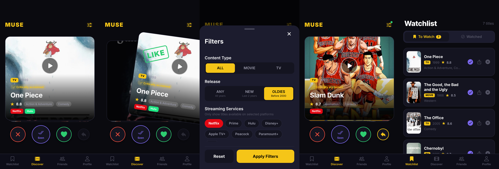

# Muse

Swipe right on movies and shows you like, left on ones you don't. A server-side
recommender learns from every swipe (yours and everyone else's) and keeps the
deck filtered by streamer, genre, and new releases vs. oldies.



## Run it

Requires Node 22+, pnpm 10, and a free [TMDB API Read Access Token](https://www.themoviedb.org/settings/api).

```bash
pnpm install
```

```bash
cp .env.example .env    # then paste your TMDB token into .env
```

```bash
pnpm db:up && pnpm db:push    # optional: Postgres via Docker. Skip both to use an in-memory store.
```

```bash
pnpm dev
```

`pnpm dev` starts the API on http://localhost:8080 and Expo. In the Expo terminal press
**w** for the web app (http://localhost:8081), **i** for the iOS simulator, **a** for
Android, or scan the QR code with Expo Go on your phone.

**On a physical phone** the app can't reach `localhost`. Create `apps/mobile/.env` with
your computer's LAN address:

```
EXPO_PUBLIC_API_URL=http://192.168.1.20:8080
```

## Layout

| Path | What |
|---|---|
| `apps/mobile` | Expo / React Native app (Discover, Watchlist, Friends, Profile) |
| `apps/api` | Express API: TMDB proxy + recommender (`src/recsys`) |
| `packages/db` | Drizzle schema + Postgres client |

## Checks

```bash
pnpm typecheck
```

```bash
pnpm test    # API routes + recommender against a fake TMDB, no network or DB needed
```

```bash
pnpm --filter @muse/api run recsys:simulate    # synthetic users: like-rate vs baselines
```

## How recommendations work

Two stages, following NVIDIA's competition-winning recipe: several cheap retrievers
(TMDB discover lists for your filters, "people who liked this also liked", TMDB's
similar titles, content similarity) propose candidates; a gradient-boosted tree model
blended with logistic regression ranks them from engineered features (target/count
encodings, your genre/era affinities, similarity to what you liked vs skipped). It
retrains in the background as swipes come in and only replaces the hand-tuned starting
ranker when it scores better on the newest swipes. Details in `CLAUDE.md`.
